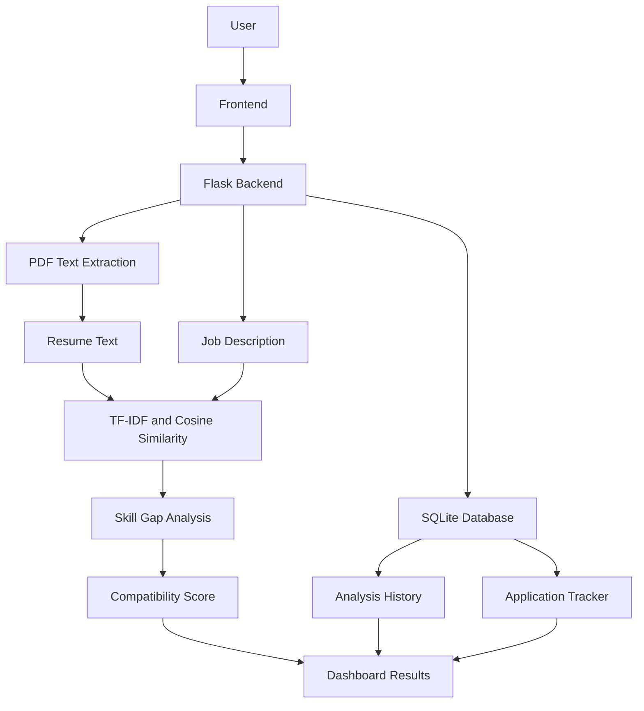

# SkillSync | AI-Powered Job Matching & Skill Gap Analyzer

<p align="center">
  **Analyze Your Resume. Discover Skill Gaps. Find Your Next Opportunity.**
</p>

<p align="center">
  A full-stack web application that helps students analyze resumes against job descriptions, identify missing technical skills, and manage internship applications.
</p>

---

## Overview

SkillSync is an NLP-powered resume analysis and job matching platform designed to help students and aspiring developers understand how well their resumes align with internship and job requirements.

Users can upload a PDF resume, paste a job description, and receive a compatibility score based on text similarity and technical skill coverage.

The platform also provides skill gap analysis, resume improvement suggestions, analysis history, and an internship application management dashboard.

## Key Features

### 1. Resume Analyzer
- Upload resumes in PDF format.
- Extract resume text using PyMuPDF.
- Automatically detect technical skills.
- Compare resumes with job descriptions.

### 2. Job Matching Engine
- TF-IDF text vectorization.
- Cosine similarity calculation.
- Weighted resume-job compatibility scoring.
- Technical skill coverage analysis.

### 3. Skill Gap Analysis
- Identify matched technical skills.
- Detect missing skills from job descriptions.
- Display skills extracted from the resume.
- Highlight areas for improvement.

### 4. Resume Improvement Suggestions
- Generate recommendations based on detected skill gaps.
- Suggest improvements to project descriptions.
- Encourage relevant technical skills and measurable achievements.

### 5. Analysis History
- Save previous resume analyses.
- Track company names and job roles.
- Store compatibility scores and analysis dates using SQLite.

### 6. Internship Application Tracker
- Add job and internship applications.
- Track Applied, Interview, Selected, and Rejected statuses.
- Update and delete application records.

### 7. Analytics Dashboard
- Track total applications.
- Monitor interviews and selections.
- Visualize application status distribution using Chart.js.

---

## Technology Stack

| Category | Technologies |
|---|---|
| Programming Language | Python |
| Backend | Flask |
| Frontend | HTML5, CSS3, JavaScript |
| Database | SQLite |
| NLP | TF-IDF, Cosine Similarity |
| ML Library | Scikit-learn |
| PDF Processing | PyMuPDF |
| Data Visualization | Chart.js |
| Version Control | Git, GitHub |

---

## System Architecture



---

## How the Matching Algorithm Works

SkillSync uses a weighted scoring algorithm combining text similarity and technical skill coverage.

**1. Resume Extraction**

PyMuPDF extracts readable text from the uploaded PDF.

**2. Text Vectorization**

TF-IDF converts resume and job description text into numerical feature vectors.

**3. Cosine Similarity**

Cosine similarity calculates the similarity between the two text representations.

**4. Skill Extraction**

A predefined technical skill dictionary identifies skills in the resume and job description.

**5. Final Compatibility Score**

```text
Final Score =
(0.40 × Text Similarity) +
(0.60 × Skill Coverage)
```

Where:

```text
Skill Coverage =
(Matched Job Skills / Total Job Skills) × 100
```

The resulting score is an estimated compatibility indicator, not a probability of getting hired.

---

## Project Structure

```text
SkillSync/
│
├── app.py
├── requirements.txt
├── README.md
├── Procfile
├── .gitignore
│
├── templates/
│   └── index.html
│
├── static/
│   ├── style.css
│   └── script.js
│
├── instance/
│   └── skillsync.db
│
└── screenshots/
    ├── dashboard.png
    ├── resume-analyzer.png
    ├── analysis-history.png
    └── application-tracker.png
```

The SQLite database is generated locally and is excluded from version control.

---

## Installation and Setup

### Prerequisites

- Python 3.11 or later
- Git
- Visual Studio Code
- Modern web browser

### 1. Clone the Repository

```bash
git clone https://github.com/akshraaa18-coder/SkillSync-AI-Job-Matcher.git
```

### 2. Navigate to the Project

```bash
cd SkillSync-AI-Job-Matcher
```

### 3. Create a Virtual Environment

```bash
python -m venv venv
```

### 4. Activate the Environment

Windows:

```bash
venv\Scripts\activate
```

macOS/Linux:

```bash
source venv/bin/activate
```

### 5. Install Dependencies

```bash
pip install -r requirements.txt
```

### 6. Run the Application

```bash
python app.py
```

### 7. Open in Browser

```text
http://127.0.0.1:5000
```

---

## API Endpoints

| Method | Endpoint | Function |
|---|---|---|
| GET | `/` | Load dashboard |
| POST | `/api/analyze` | Analyze uploaded resume |
| GET | `/api/history` | Retrieve analysis history |
| GET | `/api/applications` | Retrieve applications |
| POST | `/api/applications` | Add application |
| PATCH | `/api/applications/<id>` | Update application status |
| DELETE | `/api/applications/<id>` | Delete application |
| GET | `/api/stats` | Retrieve dashboard statistics |

---

## Future Enhancements

- User authentication and individual profiles.
- Advanced semantic resume matching.
- AI-powered resume feedback.
- Job recommendation engine.
- Integration with job listing platforms.
- Exportable resume analysis reports.
- PostgreSQL database support.

---

## Current Limitations

- Skill extraction uses a predefined technical skill dictionary.
- Matching uses TF-IDF rather than contextual language embeddings.
- Scanned PDFs without readable text are not supported.
- The current version is a single-workspace prototype without multi-user authentication.
- Compatibility scores are guidance, not hiring predictions.

---

## Author

**Akshara Dubey**

BE Computer Engineering Student | Aspiring Full-Stack Developer

GitHub: https://github.com/akshraaa18-coder

---

<p align="center">
  Built with Python, Flask, JavaScript, and a passion for solving real-world problems.
</p>
