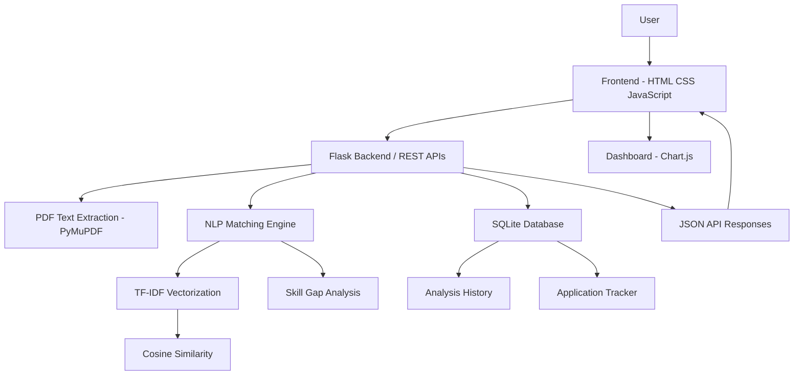

# SkillSync | AI-Powered Job Matching & Skill Gap Analyzer

<p align="center">
  <b>Analyze your resume. Discover skill gaps. Find your next opportunity.</b>
</p>

<p align="center">
  A full-stack web application that helps students evaluate their resumes against job descriptions, identify missing technical skills, and manage internship applications.
</p>

---

## Overview

SkillSync is an NLP-powered resume analysis and job matching platform designed to help students and aspiring developers understand how well their resumes align with internship and job requirements.

Users can upload a PDF resume, paste a job description, and receive a compatibility score based on text similarity and technical skill coverage.

The platform also provides skill gap analysis, resume improvement suggestions, historical analysis tracking, and an internship application management dashboard.

## Screenshots

### Dashboard


### Resume Analyzer


### Analysis History


### Application Tracker


---

## Features

### 1. Resume Analysis
- Upload resumes in PDF format.
- Extract resume text using PyMuPDF.
- Automatically identify technical skills.
- Analyze resume content against job descriptions.

### 2. Job Matching Engine
- Generate compatibility scores using TF-IDF vectorization.
- Calculate cosine similarity between resume and job description text.
- Combine text similarity and skill coverage into a weighted score.

### 3. Skill Gap Analysis
- Identify skills present in both the resume and job description.
- Detect missing technical skills.
- Display extracted resume skills.
- Help users identify areas for improvement.

### 4. Resume Improvement Suggestions
- Generate rule-based recommendations from detected skill gaps.
- Suggest improvements to relevant project descriptions.
- Encourage clearer presentation of technical skills and achievements.

### 5. Analysis History
- Store previous resume analyses.
- Track company names, job roles, and compatibility scores.
- Save analysis dates in an SQLite database.

### 6. Internship Application Tracker
- Add internship and job applications.
- Track application statuses.
- Update or delete application records.
- Organize applications into Applied, Interview, Selected, and Rejected categories.

### 7. Analytics Dashboard
- Display total applications.
- Track interview and selection counts.
- Visualize application status distribution using Chart.js.

---

## Technology Stack

| Category | Technologies |
|---|---|
| Frontend | HTML5, CSS3, JavaScript |
| Backend | Python, Flask |
| Database | SQLite |
| NLP | TF-IDF, Cosine Similarity |
| Machine Learning Library | Scikit-learn |
| PDF Processing | PyMuPDF |
| Data Visualization | Chart.js |
| Version Control | Git, GitHub |

---

## System Architecture



---

## How the Matching Algorithm Works

SkillSync uses a weighted scoring approach combining text similarity and technical skill coverage.

**Step 1: Resume Extraction**

PyMuPDF extracts readable text from the uploaded PDF resume.

**Step 2: Text Processing**

TF-IDF vectorization converts resume and job description text into numerical feature vectors.

**Step 3: Text Similarity**

Cosine similarity measures the similarity between the two text representations.

**Step 4: Skill Extraction**

A predefined technical skill dictionary and pattern matching identify skills in both documents.

**Step 5: Compatibility Score**

The final score is calculated using:

```text
Final Score =
(0.40 × Text Similarity) +
(0.60 × Skill Coverage)
```

Where:

```text
Skill Coverage =
(Matched Job Skills / Total Job Skills) × 100
```

The score is a heuristic compatibility indicator, not a probability of getting hired.

---

## Project Structure

```text
SkillSync/
│
├── app.py
├── requirements.txt
├── README.md
├── Procfile
├── .gitignore
│
├── templates/
│   └── index.html
│
├── static/
│   ├── style.css
│   └── script.js
│
├── instance/
│   └── skillsync.db
│
└── screenshots/
    ├── dashboard.png
    ├── resume-analyzer.png
    ├── analysis-history.png
    └── application-tracker.png
```

The SQLite database is generated locally when the application starts and is excluded from version control.

---

## Installation and Setup

### Prerequisites

- Python 3.11 or later
- Git
- Visual Studio Code or another code editor
- A modern web browser

### 1. Clone the Repository

```bash
git clone YOUR_GITHUB_REPOSITORY_URL
```

```bash
cd SkillSync
```

### 2. Create a Virtual Environment

```bash
python -m venv venv
```

### 3. Activate the Environment

Windows:

```bash
venv\Scripts\activate
```

macOS/Linux:

```bash
source venv/bin/activate
```

### 4. Install Dependencies

```bash
pip install -r requirements.txt
```

### 5. Run the Application

```bash
python app.py
```

### 6. Open in Browser

```text
http://127.0.0.1:5000
```

---

## API Endpoints

| Method | Endpoint | Description |
|---|---|---|
| GET | `/` | Load dashboard |
| POST | `/api/analyze` | Analyze uploaded resume |
| GET | `/api/history` | Retrieve analysis history |
| GET | `/api/applications` | Retrieve applications |
| POST | `/api/applications` | Add application |
| PATCH | `/api/applications/<id>` | Update application status |
| DELETE | `/api/applications/<id>` | Delete application |
| GET | `/api/stats` | Retrieve dashboard statistics |

---

## Future Enhancements

- User authentication and individual user profiles.
- Advanced semantic resume matching.
- AI-powered resume feedback and recommendations.
- Job recommendation engine.
- Integration with job listing platforms.
- Exportable resume analysis reports.
- PostgreSQL support for production deployment.

---

## Current Limitations

- The skill extraction system uses a predefined technical skill dictionary.
- Text matching uses TF-IDF rather than contextual language embeddings.
- Scanned PDFs without readable text are not supported.
- The current application is a single-workspace prototype and does not provide multi-user authentication.
- Matching scores should be treated as guidance, not hiring predictions.

---

## Author

**Akshara Dubey**

BE Computer Engineering Student | Aspiring Full-Stack Developer

GitHub: [Add your GitHub profile URL]

LinkedIn: [Add your LinkedIn profile URL]

---

<p align="center">
  Built with Python, Flask, JavaScript, and a passion for solving real-world problems.
</p>